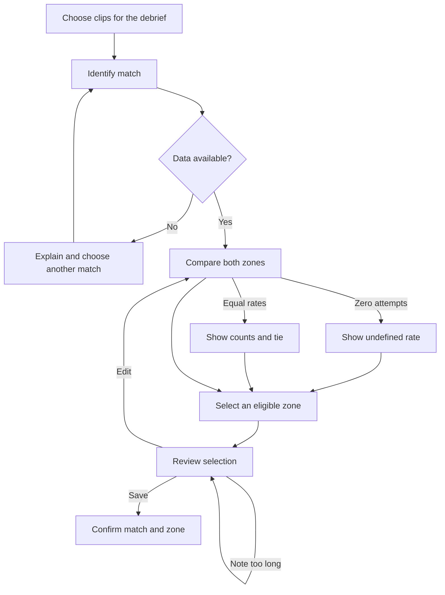

# Screen map and task flow

**Content inventory, in priority order.** Match identity → zone, goals, attempts and derived rate → candidate choice → save status → optional note. The sitemap groups Match list → Match comparison → Selection review → Saved receipt. The shot map and table are views of the same match.

**Label check.** In the three scripted examples, “Conversion” was read as a goal count, “Select pattern” sounded like selecting a dot, and “Save candidate” sounded like saving a whole match. The comparison now shows goals and attempts together. The prompt asks “Which zone will you review on video?” The next two actions are “Review selection” and “Save for video review.”

The match picker, comparison, selection review and receipt became the four main wireframes.

[FigJam flow](https://www.figma.com/board/VBS5Rkxi8Wo0WOWR1HYMJs)
