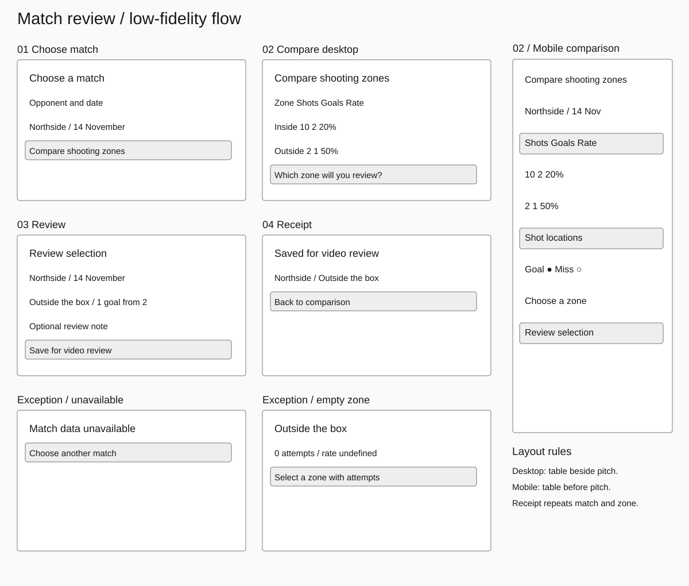

# Wireframes

The comparison is the main decision screen. On a larger screen, the coach can read the table beside the pitch. On mobile the table comes first so the goal and shot counts are visible before the markers. A match with no data leads back to the picker. A zone with no attempts shows a dash for its rate.

[Desktop wireframe](https://www.figma.com/design/UZGFEctx8ckCYBNd13DlqQ?node-id=2-26) · [Mobile wireframe](https://www.figma.com/design/UZGFEctx8ckCYBNd13DlqQ?node-id=47-138)
