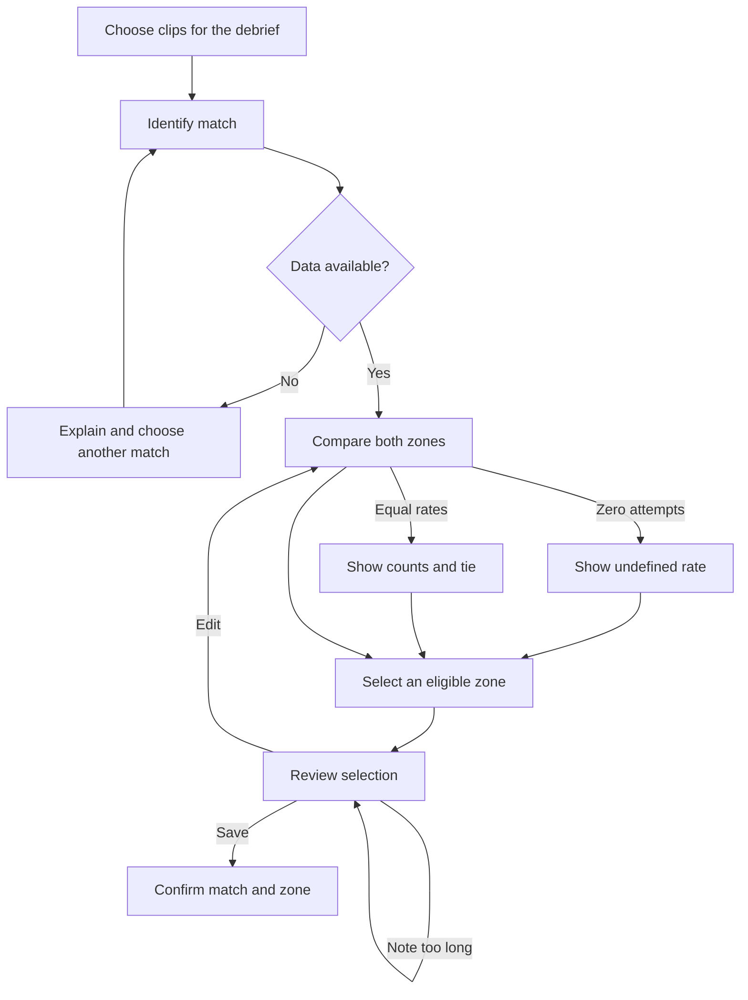

# From a match question to a saved video candidate

**Pitch.** A coach has ten minutes before a debrief. Two inside goals beat one outside goal in volume, yet one goal from two outside shots gives the higher rate. Which clips deserve a closer look?

**Brief and assumptions.** The coach wants one defensible review candidate; staff want a focused debrief. The obstacle is reading the rate without its denominator, which can lead to an unsupported training decision. The brief supplies the comparison task. The worked match supplies counts. The riskiest assumption is that a spatial map improves the explanation. Live event feeds, clip playback and tactical prediction are outside scope. Success is correct unaided interpretation within 60 seconds for ≥80% of a sample.

| Stakeholder | Need | Constraint |
|---|---|---|
| Coach | Explain one candidate | Limited preparation time (assumption) |
| Student analyst | Trace rate back to counts | Illustrative events only |
| Developer | Implement states consistently | No production service or persistence |
| Instructor | Inspect process and evidence | Simulation and observation must be distinguishable |

**User story.** As the debrief coach I want to see where a pattern comes from so I can choose a clip sequence and explain the choice. Three design questions guided selection. How might we expose sample size? How might we make shot outcomes readable without color? How might we communicate the point when a choice becomes saved?

| Estimated user impact ↓ / feasibility → | Easy within semester | More effort |
|---|---|---|
| High | Pair counts with rates; put the marker key on the pitch panel; show a receipt with zone and match | Compare the same data in two layouts |
| Lower | Identify fixtures by opponent and date; add an optional review note | Play synchronized video; integrate a live feed |

Estimates are design judgments. Start with the counts and a visible receipt because the primary task depends on both. Keep the map switchable so its contribution can be investigated.

**Content inventory, in priority order.** Match identity → zone, goals, attempts and derived rate → candidate choice → save status → optional note. The sitemap groups Match list → Match comparison → Selection review → Saved receipt. The shot map and table are views of the same match.

**Wireframe handoff.** Four frames: match picker, comparison, review, receipt. Place unavailable data at comparison entry; show zero attempts within the affected row. Desktop places the pitch beside the table; mobile stacks them with the table first. Keep one heading per view, one primary action, and a separate back action. The HTML companion implements this sequence. The original Figma file remains the native design reference.

**UI guideline.** Body 17 px, section heading about 22 px, main heading 32–58 px; system sans. Use spacing steps of 8, 16, 24 and 32 px. Action #075B45 on white, body #16332B on white, focus #9A3B00 on white. White-on-action contrast exceeds 8:1. Use outline plus shape and text for marker meaning. Primary button advances, secondary returns, disabled waits for an eligible selection. Optional note has labeled default, outlined focus and text-error states. Radio buttons select exactly one zone. Tabbing follows reading order. New screens focus the heading. The table carries the map's numeric equivalent.

**Developer rules for comparison.** No data → offer another match. Zero attempts → dash, explanatory message and disabled choice. Equal rates → present both counts. A valid selection enables review. Back retains the selected zone. Changing fixture clears it. Optional note beyond 80 characters stays in review with a field-linked message. Confirmation repeats the fixture, zone and note. Demo state lasts only for the current page session. All fixtures are bundled; there is no asynchronous data load.
